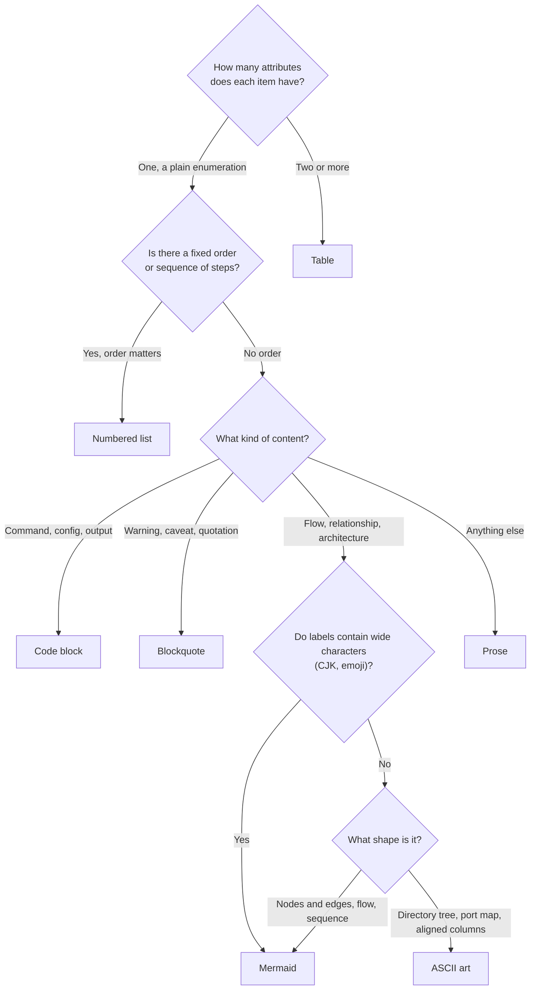
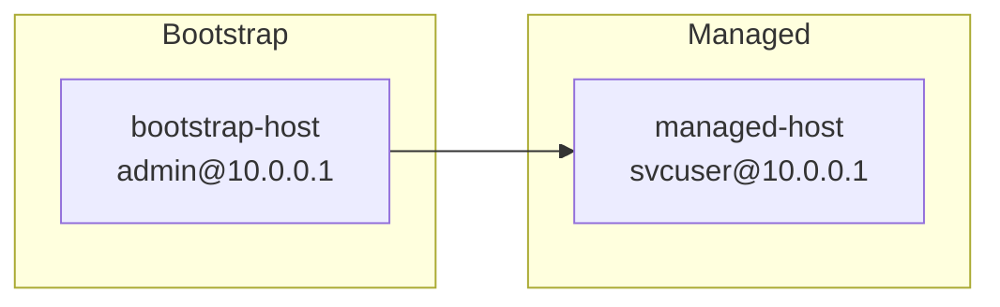

# Markdown Authoring

Use this guide when writing or rewriting `docs/` pages, KB articles, READMEs, runbooks, and any other Markdown document meant for
human readers. The goal is documents a reader can scan: facts with attributes line up in tables, dangers stand out, commands can be
copied, and structure is drawn rather than described.

> Lists are the last resort, not the default. Before writing `1.` or `-`, ask whether this is really a table, a blockquote, a code
> block, or a diagram.

The repository's own documentation rules always win over this skill. If a contributing guide or doc template says otherwise, follow
it.

## Working with Markdown-Format

This skill and the `formatting` skill split the job:

| Skill | Decides |
| :---- | :------ |
| `authoring` | Which element carries each piece of content: table, alert, code block, diagram, list, or prose |
| `formatting` | How that element is written: heading levels, blank lines, list markers, fences, table alignment, line length, and the project's linter |

Work in that order. Decide the structure with this skill, write the document, then apply `formatting` in authoring mode to the files
you touched, so the result passes the project's Markdown linter (or rumdl with markdownlint defaults when the project has none).
Structure first, because choosing a table instead of a list changes what there is to format; formatting first would be redone.

For any syntax or lint question, follow `formatting`, not this skill. If `formatting` is not installed, still write to rumdl's
default rules and run the project's Markdown linter if it has one.

## When to Apply

| Situation | Action |
| :-------- | :----- |
| Writing a new Markdown document | Apply this guide automatically |
| Editing an existing document with an established format | Follow the document's format; do not reformat it unasked |
| The user explicitly asks to rewrite or reformat | Apply this guide systematically to the whole document |
| File format prescribed by a template or tool | Follow that format (Keep a Changelog, ADR templates, generated docs) |

An established writing style wins on small edits because a document that mixes two styles is harder to read than one consistent
style, even an imperfect one. When you notice an existing document would benefit from this guide, you can suggest a rewrite instead
of doing it.

## Done Criteria

When you finish writing or rewriting, the document should meet all of these:

- No numbered list that only enumerates properties; those are tables.
- Important limitations and warnings are in blockquotes, not buried in lists.
- Runnable commands, multi-line config, and sample output are in code blocks.
- Service lists, variable lists, and status lists are tables, with empty cells left blank.
- Architecture and flows are drawn: Mermaid, or ASCII art when every label is narrow (see [ASCII art](#ascii-art)).
- The document's purpose is stated in prose, not bullets.
- Images have meaningful alt text and a sentence of prose below them.
- Links to files in the same repository use relative paths.
- A document with five or more `##` sections has a table of contents.
- The file passes `formatting` (the project's Markdown linter).

## Choosing an Element



## Tables

Use a table when any of these is true:

- Items have two or more attributes (name and description, path and purpose, variable and type and default).
- Readers need to compare items.
- The content is a mapping (A to B, such as service to container name to port).
- The content is a status overview (service to expected state).

A table lets the reader scan one column and read across one row; a list of `name: value, value` lines forces them to parse every
line. The typical rewrite turns a numbered list of variables into this:

| Variable | Type | Description |
| :------- | :--- | :---------- |
| `app_image_name` | string | Docker image name |
| `app_image_tag` | string | Docker image tag |
| `db_encryption_key` | Vault | Database encryption key |
| `app_user_password` | Vault | Application user password |

Leave a cell empty when an item has no value for that column. A dash or "n/a" in every gap is visual noise, and an empty cell
already reads as "nothing here".

Read [references/tables.md](references/tables.md) for before/after rewrites of service endpoints, design details, expected states,
and CI results.

## Blockquotes

Blockquotes pull information out of the main flow so it cannot be skimmed past. Use
[GitHub alert syntax](https://docs.github.com/en/get-started/writing-on-github/getting-started-with-writing-and-formatting-on-github/basic-writing-and-formatting-syntax#alerts)
for callouts; GitHub, GitLab, and Obsidian render it with an icon and color, and other renderers still show a readable blockquote.

| Kind | When to use | Format |
| :--- | :---------- | :----- |
| Warning | Doing it wrong causes data loss or an outage | `> [!WARNING]` |
| Caution | An action is destructive or cannot be undone | `> [!CAUTION]` |
| Important | A limitation or prerequisite that is easy to miss | `> [!IMPORTANT]` |
| Note | Supplementary detail or background | `> [!NOTE]` |
| Tip | A shortcut or easier way | `> [!TIP]` |
| Core principle | The one key sentence at the start of a document or section | Bare `>`, no label |
| Source | The source header of a KB article | `> Source: [Title](url)` |

```markdown
> [!WARNING]
> Do not edit the rendered config files on the remote host. The next automation run overwrites them.
```

The alert marker must be alone on the first line of the blockquote, and alerts cannot be nested. If the repository already uses a
different callout style (such as `> **Warning:**`) or targets a renderer that shows `[!WARNING]` as literal text, match that
instead.

Callouts lose their force when overused:

- Place each callout next to the step or fact it qualifies, not in a collected "Notes" section at the end.
- Do not stack callouts back to back. A run of callouts reads as noise and the reader stops seeing any of them. Put a sentence
  between them, or fold the lesser one into prose or a table. (Plain blockquotes separated only by a blank line also trip lint rule
  `MD028`, because some parsers merge them into one.)
- More than three caveats in one place belong in a table; keep only the most dangerous one as a blockquote.
- Do not wrap procedure steps in a blockquote. Steps go in a numbered list or a code block.

Read [references/blockquotes.md](references/blockquotes.md) for a full before/after rewrite of a "Notes" list.

## Code Blocks

Fence these in a code block:

- Runnable commands (shell, Ansible, Docker).
- Multi-line configuration (YAML, `.env`, INI).
- Sample output.

Put paths, file names, variable names, and other identifiers that appear inside prose or table cells in inline code, never plain
text, so they are unambiguous and can be copied exactly: `/srv/app/containers/myapp`, `db_encryption_key`.

`formatting` requires every fence to have a language tag. Choose the tag by content:

| Content | Tag |
| :------ | :-- |
| Shell commands | `bash` |
| YAML, Ansible vars | `yaml` |
| `.env` or INI files | `ini` |
| SQL | `sql` |
| JSON | `json` |
| Plain text output | `text` |
| Mermaid diagram | `mermaid` |

Merge consecutive commands into one block. A reader running a procedure wants to copy it once, and a run of tiny blocks reads as
disconnected fragments:

```shell
ssh svcuser@10.0.0.1
cd /srv/app/containers
docker compose ps
```

Read [references/code-blocks.md](references/code-blocks.md) for before/after rewrites, including environment variables written as a
numbered list.

## Mermaid Diagrams

| Situation | Diagram type |
| :-------- | :----------- |
| Dependencies or calls between services | `flowchart TD` or `flowchart LR` |
| Deployment flow, CI pipeline stages | `flowchart TD` |
| Host management (bootstrap host to managed hosts) | `flowchart LR` with `subgraph` |
| Request/response timing (API round trips) | `sequenceDiagram` |
| Any diagram whose labels contain wide characters | Always Mermaid, never ASCII art |

Node naming:

- Node IDs are short uppercase English abbreviations: `APISERVER`, `PG`, `REDIS`.
- Node labels carry the full name, plus the port when relevant: `APISERVER["API Server<br>8080"]`.
- Database nodes use the cylinder shape `[(...)]`: `PG[("PostgreSQL<br>5432")]`.

> [!IMPORTANT]
> Always wrap node labels in double quotes and use `<br>` for line breaks, never `\n`. In Mermaid v11 (the version GitHub uses), the
> flowchart parser fails on a bare `\n` in an unquoted label, and inside quotes `\n` renders as literal text instead of a line
> break. Quotes are also required whenever a label contains `@`, `:`, `(`, or similar symbols.



Read [references/mermaid.md](references/mermaid.md) for deployment flow, service dependency, and sequence diagram examples.

## ASCII Art

> [!IMPORTANT]
> ASCII art may contain only narrow characters: ASCII letters, digits, symbols, and box-drawing characters (`├ ─ │ └ ┌ ┐`). If any
> label needs a wide character (CJK text, full-width punctuation, most emoji), use Mermaid instead. Wide characters take two columns
> in a monospace font, and viewers disagree on their width outside one, so the columns no longer line up.

With narrow labels only, ASCII art beats Mermaid for these:

| Situation | Why |
| :-------- | :-- |
| Directory structure | A simple tree that needs no arrow semantics |
| Port layout, IP mapping | Aligned columns read more directly than a graph |

Tag ASCII art blocks as `text`:

```text
playbook/
├── overview/
│   ├── project-overview.md
│   └── architecture.md
├── services/
│   ├── app-deploy.md
│   └── worker-deploy.md
└── operations/
    ├── runbook.md
    └── secrets-vault.md
```

Read [references/ascii-art.md](references/ascii-art.md) for a port layout and a misaligned wide-character example.

## Numbered Lists

Use a numbered list in only two cases:

1. **Strictly ordered steps**, where the order cannot change: build, upload, load, run.
2. **A short single-attribute enumeration**: three items or fewer, with no second attribute to add. A bullet list or a sentence
   works equally well here.

To decide, ask of any list: "Could each item get another column?" If yes, make it a table. A numbered list of more than five items
can almost always become one.

## Document Opening

State the document's purpose in a prose paragraph, in a `## Purpose` section or directly under the title, never as bullets. A
paragraph forces the writer to say how the facts connect, which a bullet list lets them skip:

```markdown
## Purpose

This document describes how the application is deployed in the current environment, the design decisions behind it, and the variables that matter. It assumes the target host cannot pull from a registry and the network is not suitable for building remotely.
```

## Headings

Heading syntax and levels are `formatting`'s job. What this skill decides is the outline: `##` sections for the major parts of the
document (purpose, design, operations, troubleshooting), and `###` subsections for a specific service or step within one.

Give every heading a name that says what is inside, such as "CI Variables and Protected Branches". Avoid empty headings such as
"Notes", "Other", or "Miscellaneous": they become a dumping ground, and a reader scanning the outline cannot tell what they hold.

## Images

| Situation | Why |
| :-------- | :-- |
| UI screenshots | The steps differ by interface and a picture is clearer than words |
| Complex architecture or flow charts | Too many nodes for Mermaid to stay readable |
| Charts from external tools | Exported from Grafana, draw.io, and similar |

- Use relative paths and keep image files together in `./images/`: ``.
- Write meaningful alt text; never leave it empty or write "image": ``.
- Add a sentence of prose below the image saying what to notice, so it does not stand alone.
- Do not make screenshots the backbone of a procedure; they go stale. Write the steps as code blocks with explanation and use
  screenshots to support them.

## Links

| Situation | Approach |
| :-------- | :------- |
| Link within the same repository | Relative path: `[Design overview](../design/overview.md)` |
| Anchor within the same document | Fragment link: `[When to apply](#when-to-apply)` |
| Other repositories, external sites | Full URL |

> [!IMPORTANT]
> Do not use absolute URLs to point at files inside the same repository. They break when the branch changes or the repository moves.

## Table of Contents

Add a table of contents when the document has five or more `##` sections. Below that, it is maintenance burden with no navigation
benefit. Place it after the title and before the first `##` section:

```markdown
# Document Title

## Contents

- [When to apply](#when-to-apply)
- [Tables](#tables)
- [Code blocks](#code-blocks)

## When to apply
```

> [!TIP]
> Tools such as `markdown-toc` or `gh-md-toc` generate the list and keep it accurate.

## Footnotes

| Good for | Not for |
| :------- | :------ |
| Sources, version notes | Procedure steps (use a numbered list) |
| Side details that do not affect the main thread | Important warnings (use a blockquote) |
| Definitions of abbreviations | |

```markdown
This design follows the official recommendation[^1] and adds a local environment constraint[^2].

[^1]: [Official documentation](https://example.com)
[^2]: The local NFS mount does not support file locks, so this uses Postgres advisory locks instead.
```

## Anti-Patterns

| Anti-pattern | Fix |
| :----------- | :-- |
| Numbered list of five or more items with attributes | Table |
| Service endpoints as `1. Service: ...` | Table |
| Variable list as `1. varname` | Table with type and description columns |
| Several consecutive `bash` code blocks | Merge into one block |
| Design details all written as `1. 2. 3.` | Attributes become a table; procedure steps stay numbered |
| Important warning mixed into ordinary bullets | Pull it out into a blockquote |
| Two callouts back to back | Separate them with a sentence, or merge the lesser into prose |
| Dashes or `n/a` filling empty table cells | Leave the cell blank |
| Architecture described only in prose | Mermaid `flowchart` |
| Directory structure as a numbered list | ASCII art tree; Mermaid if any name has wide characters |
| ASCII art with wide characters (CJK, emoji) | Mermaid, so the columns cannot misalign |
| Document purpose as bullets | Prose paragraph |
| CI results as a numbered list | Table with job, status, and duration columns |
| Image alt text empty or `image` | Meaningful alt text |
| Absolute URL to a file in the same repository | Relative path |
| Table of contents in a short document | Omit it below five `##` sections |
