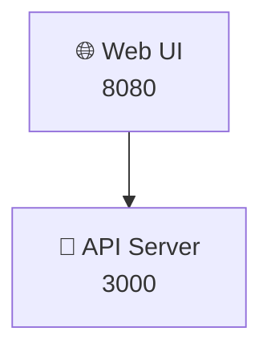

# ASCII Art Examples

Rule: only narrow characters (ASCII letters, digits, symbols, box-drawing characters). If any label needs a wide character, such as
CJK text, full-width punctuation, or most emoji, use Mermaid. Tag ASCII art blocks as `text` to prevent syntax highlighting.

## Directory Structure

```text
playbook/
├── overview/
│   ├── project-overview.md
│   └── architecture.md
├── services/
│   ├── app-deploy.md
│   └── worker-deploy.md
└── operations/
    ├── runbook.md
    └── secrets-vault.md
```

## Port Layout

```text
Host: 10.0.0.1
┌─────────────────────────────┐
│  app-web      :8080 (HTTP)  │
│  app-api      :3000 (HTTP)  │
│  app-postgres :5432 (TCP)   │
│  app-redis    :6379 (TCP)   │
└─────────────────────────────┘
```

## Wide Characters: Use Mermaid Instead (Anti-Pattern)

Do not write this. The emoji are wide, so the columns drift:

```text
Application tier
├── 🌐 Web UI      :8080
└── 🚀 API Server  :3000    <- each emoji takes two columns, or one, depending on the viewer
```

Write this instead, in Mermaid:



The same applies to CJK text and full-width punctuation: each character takes two columns in a monospace font, and viewers that fall
back to proportional fonts disagree on its width.
