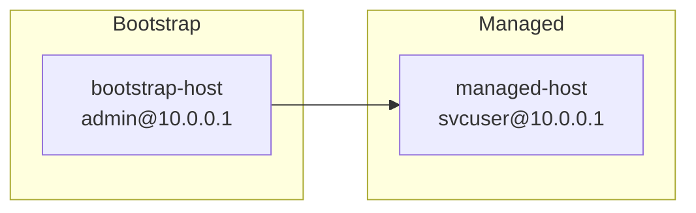
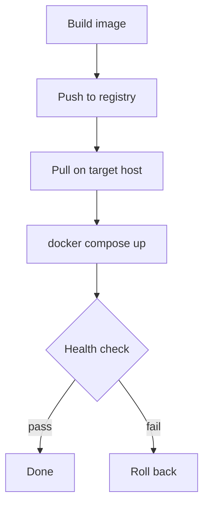
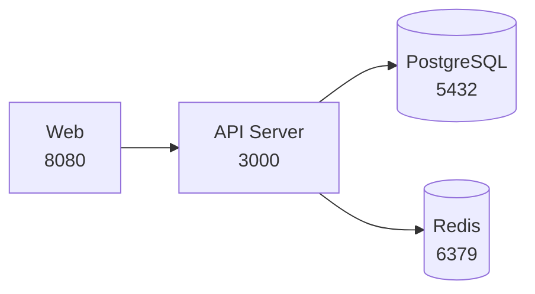
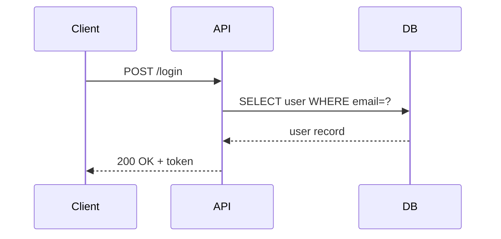

# Mermaid Diagram Examples

Rule: architecture with nodes and edges, flows, and anything whose labels contain wide characters go in Mermaid. Quote every node
label and use ` ` for line breaks.

## Contents

- [flowchart LR: host management](#flowchart-lr-host-management)
- [flowchart TD: deployment flow](#flowchart-td-deployment-flow)
- [flowchart LR: service dependencies](#flowchart-lr-service-dependencies)
- [sequenceDiagram: API call timing](#sequencediagram-api-call-timing)

## Flowchart LR: Host Management

## Flowchart TD: Deployment Flow

## Flowchart LR: Service Dependencies

## sequenceDiagram: API Call Timing

Sequence diagram messages after the `:` are free text and need no quotes.
